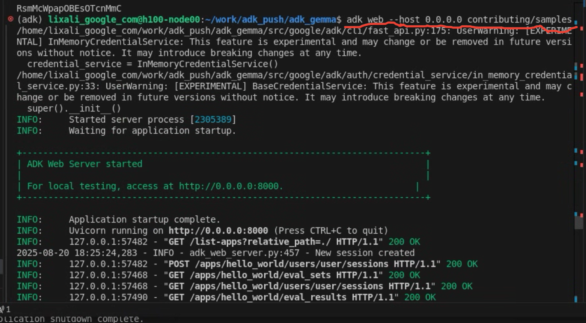
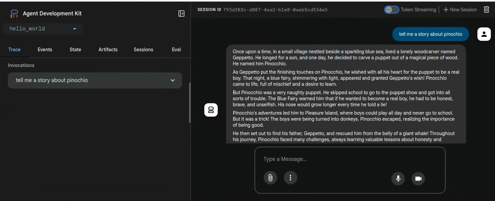

# Agent Development Kit (ADK)

[](LICENSE)
[](https://pypi.org/project/google-adk/)
[](https://github.com/google/adk-python/actions/workflows/python-unit-tests.yml)
[](https://www.reddit.com/r/agentdevelopmentkit/)
[](https://deepwiki.com/google/adk-python)

<html>
    <h2 align="center">
      
    </h2>
    <h3 align="center">
      An open-source, code-first Python toolkit for building, evaluating, and deploying sophisticated AI agents with flexibility and control.
    </h3>
    <h3 align="center">
      Important Links:
      <a href="https://google.github.io/adk-docs/">Docs</a>,
      <a href="https://github.com/google/adk-samples">Samples</a>,
      <a href="https://github.com/google/adk-java">Java ADK</a> &
      <a href="https://github.com/google/adk-web">ADK Web</a>.
    </h3>
</html>

This implementation now includes native **Gemma 3 12B model support** with model caching and efficient memory management. ADK was designed to make agent development feel more like software development, to make it easier for developers to create, deploy, and orchestrate agentic architectures that range from simple tasks to complex workflows.


---

## ✨ Key Features

- **Native Gemma 3 Model Integration**: Support for Gemma 3 12B model with 
  intelligent caching, automatic model loading, and seamless ADK integration.


## 🔥 Gemma 3 Model Integration

This implementation includes native support for **Google's Gemma 3 12B model** with several key optimizations:

## 🚀 Installation

You can install the latest stable version of ADK using `pip`:

```bash
pip install google-adk
```

### Additional Requirements for Gemma 3 Model

To use the Gemma 3 12B model, you'll need:

1. A HuggingFace account and token with access to the Gemma 3 model (request access in https://huggingface.co/google/gemma-3-12b-it )
2. Set your HuggingFace token as an environment variable:

```bash
export HUGGING_FACE_TOKEN="your_huggingface_token_here"
export PYTHONPATH="/your_repo_path/src:$PYTHONPATH"
```

3. Install additional dependencies:

```bash
pip install transformers torch accelerate
```


## 🏁 Feature Highlight

### Define a single agent with Gemma 3:

```python
from google.adk.agents import Agent
from google.adk.tools import google_search

root_agent = Agent(
    name="hello_world_agent",
    model="gemma-12b", # Native Gemma 3 12B model support
    instruction="You are a helpful assistant. Answer user questions and provide useful information",
    description="Gemma3 agent",
)
```


###  Evaluate Agents

```bash
adk web --host 0.0.0.0 contributing/samples

```



And then open browser and type in http://0.0.0.0:8000/dev-ui/?app=hello_world to interact with the agent




## 📄 License

This project is licensed under the Apache 2.0 License - see the [LICENSE](LICENSE) file for details.

---

*Happy Agent Building!*
